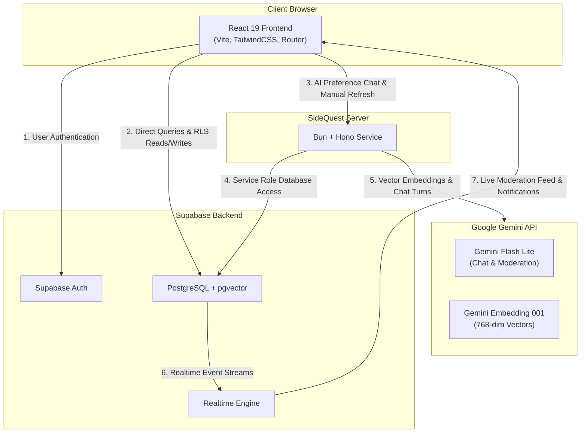

# SideQuest

SideQuest is a neighbourly job marketplace designed specifically for local communities in Jersey. It connects residents who need short-term help (such as garden maintenance, flat-pack furniture assembly, or pet sitting) with trusted local helpers.

The platform combines a discovery-focused web application, a serverless database backend with row-level security, and a dedicated backend service powered by Google Gemini models for personalised recommendations, conversational preference tuning, and autonomous content moderation.

---

## Tech Stack

### Web Application (Frontend)
* **Framework & Runtime:** React 19, Vite 8, TypeScript
* **Routing & State:** React Router 7, TanStack React Query v5
* **Styling & Design System:** TailwindCSS v4, Vanilla CSS design tokens, Lucide React icons
* **Mapping:** Leaflet and React Leaflet for interactive island maps

### Server Service (Backend)
* **Runtime & Framework:** Bun, Hono HTTP service
* **AI Integration:** Google Gemini API (`gemini-flash-lite-latest` and `gemini-embedding-001`)
* **Push Notifications:** Web-Push (VAPID protocol)

### Database & Platform (Supabase)
* **Database:** PostgreSQL with `pgvector` extension
* **Authentication:** Supabase Auth (Google OAuth and session tokens)
* **Security:** Row Level Security (RLS) policies and SECURITY DEFINER PostgreSQL triggers
* **Realtime:** Supabase Realtime subscriptions for live notifications and moderation streams

---

## Architecture & System Overview

The system consists of three primary components: the client-side single-page application, the Supabase PostgreSQL database, and the Bun-based server service.



---

## AI Capabilities

SideQuest incorporates artificial intelligence into three distinct product areas:

### 1. Conversational Preference Assistant (Job Compass)
Rather than forcing users to configure complex search filters, the Job Compass allows members to describe their availability, skills, and preferences in natural language.
* **Model:** `gemini-flash-lite-latest`
* **Functionality:** Accepts multi-turn conversations, updates a persistent semantic brief, extracts key search topics, and adjusts category selections.
* **Protections:** Enforces per-user burst limits (4 requests/minute), global burst limits (10 requests/minute), and database-tracked daily usage quotas (20 calls/user/day).

### 2. Personalised Recommendation Engine ("Picked For You")
* **Model:** `gemini-embedding-001` & `gemini-flash-lite-latest`
* **Functionality:** Computes 768-dimensional vector embeddings for open job descriptions and user preference briefs. Performs cosine similarity matches via `pgvector`, filters out candidate conflicts, and generates concise, single-sentence match rationales explaining why a job suits a specific member.
* **Execution:** Runs automatically on an hourly schedule and triggers early whenever new jobs pile up. In-flight promise locks prevent duplicate execution.

### 3. Autonomous Moderation Agent
* **Model:** `gemini-flash-lite-latest`
* **Functionality:** When a member reports a job listing or user profile, an autonomous server agent inspects the reported item against Jersey community rules, reviewing reporter feedback, historical enforcement actions, and member tenure.
* **Tool Enforcement:** The agent selects a structured tool action:
  * `dismiss`: Content adheres to community standards.
  * `remove_post`: Removes violating job listings.
  * `ban_user`: Issues a temporary 7-day to 30-day account ban for repeat or serious offences.
  * `suspend_user`: Indefinitely suspends accounts demonstrating severe policy breaches.
* **Auditability:** Every step of the agent's evaluation (`received` $\rightarrow$ `context` $\rightarrow$ `analyzing` $\rightarrow$ `decision` $\rightarrow$ `applied` $\rightarrow$ `done`) streams live to the Admin Dashboard via Supabase Realtime.

---

## How It Works

### Web Application
The single-page application is structured around responsive navigation and glassmorphism visual hierarchy:
* **Landing Page vs Home:** Signed-out visitors see an explanatory marketing landing page detailing how the platform operates. Signed-in members land directly on their discovery dashboard featuring active applications, urgent tasks, and personalised recommendations.
* **Browse Jobs:** Provides search filtering by parish and category, supported by a floating glass search bar activated by pressing `/`.
* **Member Dashboard:** Manages posted listings, multi-person helper slots, received applications, and conversation threads.
* **Admin Dashboard:** Displays system health, demo bot controls, recommendation triggers, human user listings (filtering out test bots), and the live streaming Gemini moderation audit log.

### Dual-Database Architecture
* **Development Mode:** Runs out-of-the-box using an in-memory client database (`src/lib/mockDb.ts`) with local storage persistence and simulated server delays. No external services or API keys are required for frontend interface work.
* **Production Mode:** Connects to Supabase (`src/lib/supabaseDb.ts`) for real authentication, database storage, and backend service communication.

---

## Getting Started & Local Development

### Prerequisites
* **Node.js:** v20.0.0 or higher
* **Bun:** v1.1.0 or higher (for server execution)
* **Package Manager:** `npm` or `bun`

### Installation
Clone the repository and install dependencies:

```bash
git clone https://github.com/j4ckxyz/hackathon-2026.git
cd hackathon-2026
npm install
```

### Running the Web Application
Start the local Vite development server:

```bash
npm run dev
```

The application will be available at `http://localhost:5173`. In development mode, the app uses mock data, allowing full testing of job posting, applications, and preference management without external credentials.

### Running the Backend Service
To run the server locally, create a `.env` file in the project root containing your Supabase and Gemini credentials:

```bash
# Start the Bun server
npm run server
```

The service runs on `http://127.0.0.1:8787`.

### Quality Checks
Run TypeScript compilation and linter passes:

```bash
# Type check
npx tsc --noEmit

# Code linting
npm run lint

# Production build check
npm run build
```

---

## Environment Variables Reference

Create a `.env` file in the project root for local backend execution:

```ini
# Supabase Configuration
SUPABASE_URL=https://your-project.supabase.co
SUPABASE_SECRET_KEY=your-supabase-service-role-key
SUPABASE_API_KEY=your-supabase-anon-key

# Gemini AI Configuration
GEMINI_API_KEY=your-gemini-api-key
GEMINI_EMBED_MODEL=gemini-embedding-001
GEMINI_CHAT_MODEL=gemini-flash-lite-latest

# Service Settings
PORT=8787
CRON_SECRET=your-cron-secret
NEW_JOBS_THRESHOLD=5
WATCH_INTERVAL_MS=120000

# Web Push Notifications (Optional)
VAPID_PUBLIC_KEY=your-vapid-public-key
VAPID_PRIVATE_KEY=your-vapid-private-key
VAPID_SUBJECT=mailto:hello@example.com
```

For frontend production builds (`vite build`), configure `.env.production`:

```ini
VITE_SUPABASE_URL=https://your-project.supabase.co
VITE_SUPABASE_ANON_KEY=your-supabase-anon-key
VITE_RECS_API_URL=https://recs.sidequest.je
VITE_VAPID_PUBLIC_KEY=your-vapid-public-key
```

---

## API Endpoints Reference

The backend server exposes the following HTTP endpoints:

| Endpoint | Method | Auth | Description |
| :--- | :--- | :--- | :--- |
| `/health` | `GET` | None | Returns service health status (`{"ok": true}`). |
| `/preferences` | `GET` | Bearer Token | Loads private user topic preferences and message history. |
| `/preferences` | `POST` | Bearer Token | Updates preferred categories and location visibility settings. |
| `/preferences/chat` | `POST` | Bearer Token | Sends a user message to the Gemini preference assistant. |
| `/moderate` | `POST` | Bearer Token | Triggers immediate Gemini moderation evaluation on a report. |
| `/search` | `POST` | None | Executes vector similarity search across open listings. |
| `/refresh` | `POST` | Admin / Cron | Triggers full vector embedding re-indexing and recommendation generation. |
| `/bots` | `POST` | Admin Token | Generates test resident profiles and sample local listings. |
| `/bots/remove` | `POST` | Admin Token | Cleans up all test resident profiles and associated jobs. |

---

## Deployment Notes

### Server Service Deployment (Nginx + Systemd)
1. Copy systemd unit file from `deploy/sidequest-recs.service` to `/etc/systemd/system/sidequest-recs.service`.
2. Configure environment variables in `/opt/sidequest/.env`.
3. Set up the Nginx reverse proxy configuration from `deploy/nginx-sidequest-recs.conf`.
4. Provision TLS certificates using Certbot:
   ```bash
   sudo certbot --nginx -d recs.your-domain.com
   ```
5. Enable and start the service:
   ```bash
   sudo systemctl enable --now sidequest-recs
   ```

---

## Licence

Private repository. All rights reserved.
